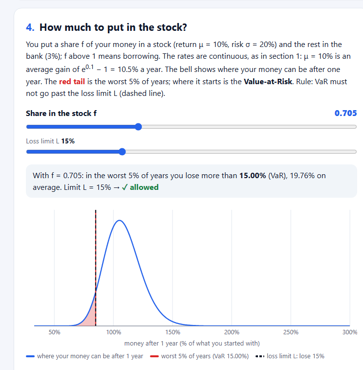
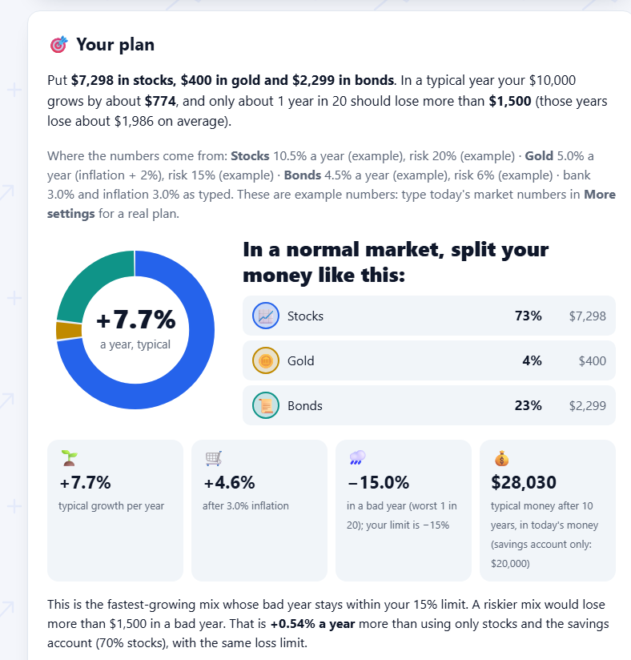
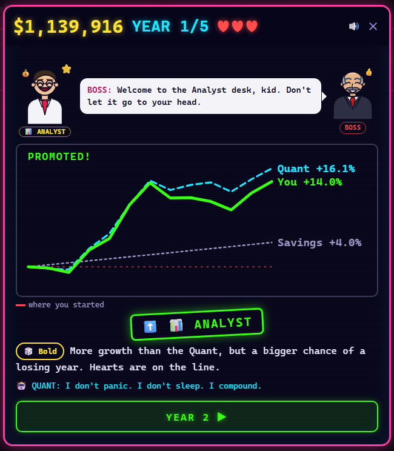
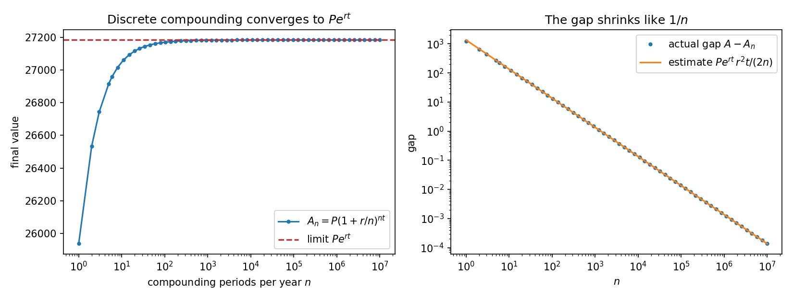
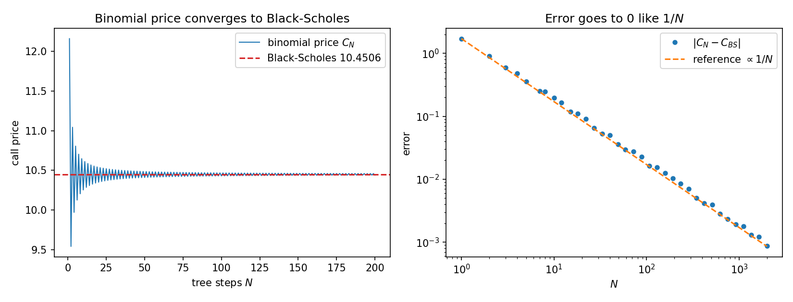
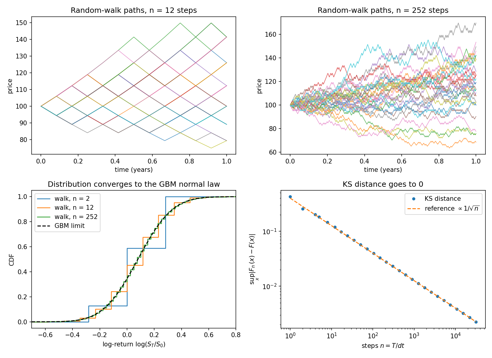
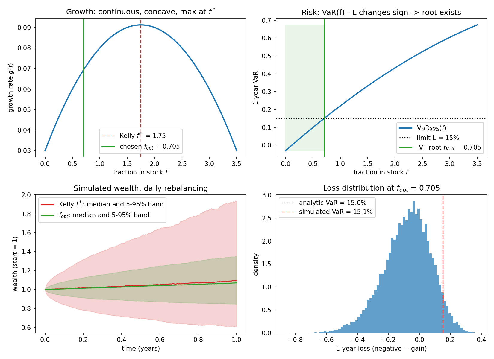
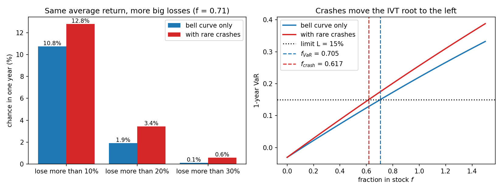
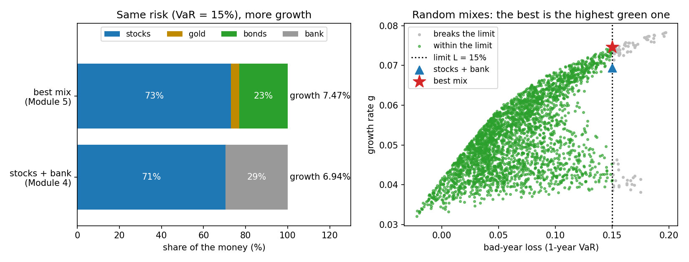

# Calculus Meets Finance

[](https://github.com/ahmetozturk86/calculus-meets-finance/actions/workflows/tests.yml)
[](LICENSE)


**How much of my savings should I put in the stock market?**
I'm a math student, and this is my own project to see how far calculus (limits, continuity and the
Intermediate Value Theorem) can go with a real money question. It has three parts that belong
together: **the math**, **The Investor**, a planner that applies it to your own money, and
**Fund Manager**, a game that lets you play against it.

**Try it in your browser**, nothing to install:
[the explainer](https://ahmetozturk86.github.io/calculus-meets-finance/web/index.html) ·
[The Investor](https://ahmetozturk86.github.io/calculus-meets-finance/web/investor.html) ·
[Fund Manager](https://ahmetozturk86.github.io/calculus-meets-finance/web/investor.html#game)

| the math | The Investor | Fund Manager |
|---|---|---|
| [](https://ahmetozturk86.github.io/calculus-meets-finance/web/index.html) | [](https://ahmetozturk86.github.io/calculus-meets-finance/web/investor.html) | [](https://ahmetozturk86.github.io/calculus-meets-finance/web/investor.html#game) |

> This is a learning project, not investment advice. The plans come from simple models and
> example numbers; they are not professional recommendations.

## Three parts

**The math.** Six modules: each one takes a discrete financial model, lets a step go to a limit, and
shows that it converges to a continuous model. The last ones use the Intermediate Value Theorem and
bisection to find the fastest-growing split of money that keeps a bad-year loss limit. Written in
**Python** (35 tests) and ported 1:1 to **MATLAB**. The idea in 2 minutes is right below.

**The Investor** (`web/investor.html`). The math applied to your own situation, in English or Turkish.
You type your money, yearly saving, bank interest, inflation, years and how much risk you can take; you
get a plan in one plain sentence ("Put $7,298 in stocks, $400 in gold and $2,299 in bonds…"), a line saying
where every number came from, and a test over 500 simulated futures. Optional extras: today's market
numbers (bond yield, stock P/E, VIX), fees and taxes (typical USA, Turkey or OECD average), the Turkish
lira with its own numbers, and real price files, which are read only inside your browser.

**Fund Manager** (the game inside The Investor). You manage $1,000,000 for 5 years with 3 hearts.
Every year brings a different market; you split the money, and the year plays out month by month
against **the Quant**, who always plays the math's plan. When the market suddenly drops, you have 8
seconds to sell, hold or buy the dip. A losing year costs a heart: climb the career ladder or get
fired. It asks the project's question in a different way: can your instinct beat bisection?

## The idea in 2 minutes

**1. Real life is discrete, the formulas are continuous.** Interest is paid monthly and prices
move tick by tick, but the best formulas are continuous. Modules 1–3 show that each discrete
model **converges** to its continuous version as the steps get smaller (n → ∞, Δt → 0), so the
continuous formulas may be used.

**2. Two formulas for one choice.** Put a share f of your money in stocks and the rest in the bank.
- Typical growth per year: g(f) = r + f(μ − r) − ½f²σ², a hill with its top at f* = (μ − r)/σ².
- Bad-year loss VaR(f): the loss that only 1 year in 20 is worse than. It grows with f, without jumps.

**3. The Intermediate Value Theorem guarantees an answer, and bisection finds it.**
With μ = 10%, σ = 20%, a bank at 3% and the rule *"lose at most 15% in a bad year"*:
with everything in the bank even a bad year gains 3% (VaR(0) = −3%, below the limit), and at f = 2 the bad year loses 43%
(above it). VaR is continuous, so somewhere in between
it equals 15% exactly. Bisection halves the interval until it finds that point:

| step | interval | middle f | VaR(middle) | keep the half where the limit is crossed |
|---|---|---|---|---|
| 1 | [0, 2] | 1 | 22.0% | too risky → [0, 1] |
| 2 | [0, 1] | 0.5 | 9.9% | safe → [0.5, 1] |
| 3 | [0.5, 1] | 0.75 | 16.1% | too risky → [0.5, 0.75] |
| 4 | [0.5, 0.75] | 0.625 | 13.0% | safe → [0.625, 0.75] |
| … | … | … | … | … |
| 41 | | **0.705014** | **15.00%** | |

**Answer: 70.5% in stocks, 29.5% in the bank.** Each step halves the error, so 41 steps give 12
correct digits. The growth top (f* = 1.75) is further out, so the risk limit decides.

**4. More assets.** Any fixed mix of stocks, gold and bonds behaves like one fund, so step 3 works for
every mix. Trying all 5,151 mixes gives **73% stocks, 4% gold, 23% bonds**: the same bad-year risk,
but 0.53% more growth a year.

## Where to start

| you have | look at |
|---|---|
| 2 minutes | the section above |
| 10 minutes | [the explainer](https://ahmetozturk86.github.io/calculus-meets-finance/web/index.html) (`web/index.html`): move the sliders; each module turns a discrete model into its limit |
| to try it on your own money | [**The Investor**](https://ahmetozturk86.github.io/calculus-meets-finance/web/investor.html) (`web/investor.html`, English / Turkish) |
| to play | [**Fund Manager**](https://ahmetozturk86.github.io/calculus-meets-finance/web/investor.html#game), the 🕹️ game inside The Investor |
| the mathematics | [Results](#results) below, and the docstrings in `src/`: each module states its limit and the idea behind it |
| the code | `src/` (Python) and `matlab/`, run with the commands below |

## The modules

| # | Module | Limit / continuity idea | Real-life question |
|---|--------|------------------------|--------------------|
| 1 | Continuous compounding | lim (1 + r/n)ⁿᵗ = eʳᵗ | Is daily compounding worth more than monthly? |
| 2 | Binomial tree → Black–Scholes | lim_{N→∞} C_N = C_BS | What is a fair price for a stock option? |
| 3 | Random walk → Geometric Brownian Motion | distribution converges as Δt → 0 | Why do we model stock prices with GBM? |
| 4 | **Risk optimization** | g'(f) as a limit, IVT on VaR(f) − L | How much should I invest in stocks? |
| 4b | Fat tails: rare crashes | Binomial(n, λ/n) → Poisson(λ), IVT twice | What if the market sometimes crashes? |
| 5 | More assets: stocks, gold, bonds, bank | one IVT + bisection per mix; grid step → 0 | What is the best mix of several assets? |

All rates in the math are continuously compounded (Module 1): μ = 10% means an average gain of
e^0.10 − 1 = 10.5% a year, and r = 3% means 3.05% a year.

## Results

### 1. Continuous compounding
10,000 at 10% for 10 years. More frequent compounding pays more, but the gain is
bounded: the gap to the limit `P e^{rt} = 27,182.82` shrinks like `1/n`.

| compounding | value | gap to limit |
|---|---|---|
| yearly | 25,937.42 | 1,245.39 |
| monthly | 27,070.41 | 112.40 |
| daily | 27,179.10 | 3.72 |
| every minute | 27,182.82 | 0.003 |



### 2. Binomial option price → Black–Scholes
A call option with S = K = 100, r = 5%, σ = 20%, T = 1. The N-step binomial price
oscillates around the Black–Scholes price 10.4506 and the error goes to 0 like `1/N`.



### 3. Random walk → GBM
A coin-flip walk with steps ±σ√Δt. As Δt → 0 the distribution of log-returns
converges to the normal law of GBM. The Kolmogorov–Smirnov distance (computed
exactly, not simulated) falls like `1/√n`.



### 4. Risk optimization
A stock with μ = 10%, σ = 20%, and a risk-free asset at r = 3%. Investing a
fraction f in the stock gives the growth rate

    g(f) = r + f(μ − r) − ½ f² σ²

* **Max growth (Kelly):** g is continuous and concave, so solving g'(f) = 0 gives
  f* = (μ − r)/σ² = **1.75** (175%, borrowed money). The 95% one-year VaR is then **38%**.
* **Risk rule:** "with 95% confidence, lose at most 15% in a year." The function
  h(f) = VaR(f) − 0.15 is continuous with h(0) < 0 < h(2), so by the
  **Intermediate Value Theorem** it has a root, which bisection finds in 41 steps:
  f_VaR = **0.705**. It is the only root for any horizon: VaR(f) = L is a quadratic
  equation whose two roots have opposite signs (the quadratic formula gives the same 0.705014).
* **Decision:** f_opt = min(f*, f_VaR) = **0.705**, so invest **70.5% in the stock and
  29.5% risk-free**. The typical (median) growth is 6.94%/year with exactly 15% VaR. A Monte
  Carlo simulation with daily rebalancing confirms it (simulated VaR ≈ 14.9–15.1%).
* **How bad are the bad years?** VaR says the worst 5% of years lose *more than* 15%; the
  **Expected Shortfall** says they lose **19.8% on average**. The same IVT + bisection on
  ES(f) − 0.15 gives f_ES = 0.547 for the stricter rule "lose at most 15% on average in the worst 5%".



### 4b. Fat tails: rare crashes
The bell curve makes big losses almost impossible, but real markets sometimes crash.
Here the stock also falls **25% about once every 10 years** (a Merton jump-diffusion).
The average return stays 10%: normal years get a little better and rare years much worse,
so the left tail gets fatter, and the long-run growth falls even though the average does not.

* **New limit:** crash coin-flips with probability λ/n in each of n steps become the
  Poisson law as n → ∞. The largest table difference falls from 9.5·10⁻³ (n = 1) to
  8.6·10⁻⁷ (n = 10,000).
* **IVT twice:** the loss distribution is now a mixture of bell curves with no inverse
  formula. Bisection finds its 5% quantile (the VaR), and a second bisection finds
  where VaR(f) hits the limit.

| at f = 0.705 | bell curve only | with rare crashes |
|---|---|---|
| 95% VaR | 15.00% | 17.47% |
| 99% VaR | 22.79% | 27.29% |
| average loss in the worst 5% (ES) | 19.76% | 23.48% |
| years losing more than 15% | 1 in 20 | 1 in 14 |
| typical growth per year | 6.94% | 6.76% |

With crashes the same rule gives **f_crash = 0.617, i.e. 61.7% in stocks** instead of
70.5%. Crashes also lower the Kelly fraction from 1.75 to 1.41 (bisection on the slope of the
growth with crashes), so the decision min(f*, f_crash) is still f_crash. A Monte Carlo check
with daily crash coin-flips gives VaR = 15.0% at f_crash.



### 5. More assets: stocks, gold and bonds
Now gold (4.9% a year, σ = 15%) and bonds (4.4%, σ = 6%) are available too; the
numbers are illustrative. **Key idea:** any fixed mix of stocks, gold and bonds
behaves like one fund, so Module 4 (IVT + bisection) gives the best share for
that fund. Trying every mix in 1% steps (5,151 bisections) and keeping the
fastest-growing one gives the best mix, with no borrowing and no short selling.

| choice | allocation | growth per year |
|---|---|---|
| stocks + bank (Module 4) | 70.5% stocks | 6.94% |
| **best mix (Module 5)** | **73% stocks, 4% gold, 23% bonds** | **7.47%** |

Same 15% bad-year risk, **+0.53% growth a year**. Bonds replace the bank because
they pay a bit more and tend to move against stocks.

The problem is convex (the growth is concave and the safe mixes form a convex set), so there
is exactly one best mix. Its top is flat, though: every mix within 0.01% a year of the best has
73% stocks, but anywhere from 1% to 7% gold. **About 73% stocks is the real message**; the
split between gold and bonds barely matters.

**Module 5's own limit: grid step → 0.** A grid twice as fine contains the coarser one, so its
best growth can only go up, and it converges to the exact best mix:

| grid step | mixes | best mix (stocks / gold / bonds) | growth |
|---|---|---|---|
| 2% | 1,326 | 72 / 12 / 16 | 7.45461% |
| 1% | 5,151 | 73 / 4 / 23 | 7.46824% |
| 0.25% | 80,601 | 73 / 4.25 / 22.75 | 7.46875% |
| 0.0625% | 1,282,401 | 72.94 / 5 / 22.06 | 7.46882% |
| → 0 (zooming in) | | 72.9 / 4.9 / 22.2 | **7.46887%** |



## Run it

### Python (3.10 or newer)
```bash
pip install -r requirements.txt
python main.py               # prints all tables, writes figures/*.png
python -m pytest             # 35 tests
python tests/web_smoke.py    # both web pages in headless Chrome or Edge: their numbers vs Python, no errors
```
GitHub Actions runs all of these on every push ([`.github/workflows/tests.yml`](.github/workflows/tests.yml)), and
`run_tests` and `main` in MATLAB too (MathWorks' MATLAB actions are free for public repositories).

### MATLAB
```matlab
cd matlab
main          % same tables, figures saved to matlab/figures/
run_tests     % same checks as the Python tests
```
Only base MATLAB is needed (R2018b or newer): the normal CDF and quantiles are
written by hand, so no Statistics Toolbox is required. Deterministic numbers
match Python exactly. Monte Carlo numbers differ slightly because the random
generators are different.

### Web pages
They run [online](https://ahmetozturk86.github.io/calculus-meets-finance/web/index.html), or open the files in a browser:
- `web/index.html`: the interactive explainer, one section per module (1, 2, 3, 4, 4b, 5). Move the big slider and
  watch each discrete model turn into its continuous limit: stairs into e^(rt), tree bars into Black–Scholes, coin-flip
  paths into GBM, the VaR limit found by IVT + bisection, rare crashes, and the best mix found by a finer and finer search.
- `web/investor.html`: **The Investor**, Modules 4 and 5 applied to your own money, in English or Turkish. You type your
  money, yearly saving, bank interest, inflation, years and how much risk you can take, and get a plan in one plain
  sentence ("Put $7,298 in stocks, $400 in gold and $2,299 in bonds…"), tested over 500 simulated futures.
- **Fund Manager**, the game inside `web/investor.html` (🕹️ button, the poster above the inputs, or `investor.html#game`): 5 years, 3 hearts,
  a different market every year, sudden drops where you decide in 8 seconds, badges and a career ladder, always
  against the Quant, who plays Module 5's best mix. It uses the same market numbers and correlations as the planner.

<details>
<summary><b>The Investor in detail</b></summary>

  1. **Your situation:** the money you have (with a currency symbol: $, €, £, ₺ or none), the money you add each
     year, the bank interest, inflation, the years and how much risk you can take. **Today's market numbers** (the
     10-year bond yield, the stock market's P/E and VIX) are optional, in More settings. Together with the bank
     interest and inflation they become each asset's expected return and risk: stocks earn about
     1/P/E plus inflation, bonds their yield, gold inflation + 2% (its price says nothing about its future), and VIX
     sets the stock risk. The market (calm, normal, crisis or high inflation) is read from VIX, inflation and
     uploaded prices. With ₺ the empty boxes use typical Turkish numbers and every number is in lira. A line under
     the plan says where every number came from. The risk choice is **Careful**, **Balanced** or **Bold**. Careful and Balanced are your
     own bad-year loss limits, the same in every market: only about 1 year in 20 should lose more than 5% or 15%
     (how much you can lose is about you, not the market). Bold has no limit except no borrowing: it is the
     fastest-growing plan without borrowing (its bad year is about 22% in a normal market). In calm and normal
     markets that is all stocks, so going further would need borrowing, which the plan never does; in crisis and
     high-inflation markets a riskier mix exists but grows slower, because big losses hurt more than big gains help.
     When even that plan stays within your limit (with the example numbers: in a high-inflation market), Balanced gives
     the same plan as Bold, and the page says so.
     All rates you type are ordinary yearly rates; the math turns them into continuous rates with ln(1 + x).
     Everything else is in a closed **More settings** section: today's market numbers, **your own guess** of how to
     split the money (optional), the stock numbers used when the P/E or VIX box is empty, **fees and taxes** (with
     typical USA, Turkey or OECD average values to fill in; the plan uses what you keep after them), surprises, and
     optional CSVs of real prices for stocks, gold and bonds, or one file with a column for each
     (`web/sample_prices.csv` is a simulated example). From the files the page estimates each asset's average return,
     risk and how the assets move together; short data is pulled toward typical long-run values, because averages are
     hard to measure. The stock prices also help read today's market. Nothing is calculated until you press **Calculate my plan**.
  2. **Your plan:** one plain sentence in money (how much to put where, a typical year's gain, the bad-year
     loss and what those bad years lose on average), then the best split between stocks, gold, bonds and the
     savings account (Module 5), with the money
     in each, the typical growth, the bad-year loss and the typical result after the chosen years. If you made a
     guess, **your guess vs the math** shows whether your split keeps your limit and how much slower it grows. If
     rare crashes are switched on, it also shows a safer crash-aware mix.
  3. **Your plan in real life:** the plan (and your guess, if you made one) is played year by year in a simulated
     future, next to the savings account, on exactly the same years. Over 500 possible futures you see who ended
     with more money and whether the plan keeps its promise ("a year over your limit at most 1 in 20"). With no surprises the promise
     holds (the plan is rebalanced once a year, so it follows the math closely, not exactly); with crises and
     crashes you see what the bell-curve math leaves out. A closed section compares more
     strategies (stocks + savings only from Module 4, all stocks, all gold, the crash-aware mix).
  4. **How we found your plan:** closed sections with the math: each asset alone vs the mix, the bell curve,
     the IVT + bisection, rare crashes (Module 4b) and the check against real history.

  **The simulated market.** Today's market starts from your numbers; calm, crisis and high-inflation markets
  are better or worse versions of it. With "markets change over time" on, they follow each other through a Markov chain, so crises tend to last
  a while. Gold, bonds and inflation use illustrative values, roughly like long-run history in developed markets.
  Crash years also move gold and bonds, and every asset's drift is adjusted so its average return stays the one in
  the table. None of this is a forecast. If you uploaded prices, the stock years come from your real data; they
  already contain real crashes and real markets, so then no crashes or market changes are simulated on top.

  The uploaded file is read only inside the page and is never sent anywhere. Neither page uses external libraries,
  so both work offline.

</details>

## Project layout
```
src/                Python modules
  bisection.py      IVT-based root finding (used everywhere)
  normal.py         normal CDF / inverse CDF without scipy
  compounding.py    Module 1
  option_pricing.py Module 2
  gbm.py            Module 3
  risk.py           Module 4 and 4b
  portfolio.py      Module 5 (more assets)
main.py             runs everything, saves figures/
tests/              pytest checks against known values (test_modules.py)
  web_smoke.py      both web pages in a headless browser, compared with the Python numbers
matlab/             one .m file per Python function + main.m, run_tests.m
web/                interactive explainer (index.html) and The Investor with the Fund Manager game (investor.html)
docs/screenshots/   the pictures at the top of this README
.github/workflows/  the tests on every push: Python, the web pages, MATLAB
```

## Limitations
The model assumes constant μ and σ, free continuous rebalancing, and borrowing at
the risk-free rate. Module 4 assumes normally distributed log-returns. Real
markets have fat tails, so a normal VaR underestimates extreme losses. Module 4b
adds rare crashes to fix part of this, but its crash size and frequency are
assumptions, not estimates. VaR only says where the bad years start; the Expected
Shortfall next to it says how bad they are on average. The point of the
project is the mathematics (limits and continuity); it is a student's learning project, not investment advice.
The gold and bond numbers of Module 5 are assumptions too, and real average
returns are hard to estimate, so the best mix can change a lot with small input
changes. The real-life test in `investor.html` breaks the assumptions on purpose
(changing markets, crash years), so the plan can break its promise there: it
shows where the simple model stops being enough.

## License
[MIT](LICENSE): you may use, change and share the code, keeping the copyright notice. The market numbers in the code
and on the pages are illustrative, and `web/sample_prices.csv` is simulated, not real prices.
